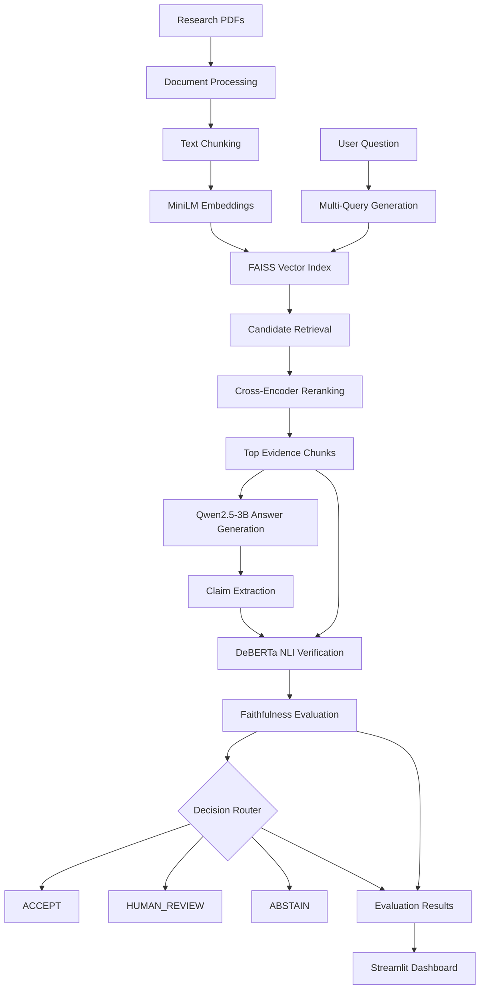

# RAG Reliability Engineer — Advanced Dashboard

A dark, technical Streamlit observability dashboard for the pilot scorecard.

## Run locally (Windows)
1. Extract the ZIP.
2. Open the extracted folder in VS Code.
3. Open Terminal in that folder.
4. Run:

```bash
py -m venv .venv
.venv\Scripts\activate
pip install -r requirements.txt
streamlit run app.py
```

If `py` is unavailable, use `python` instead.

## Data
The included `rag_reliability_final_scorecard.csv` is the pilot scorecard.
You can also upload a compatible CSV from the sidebar.

## Important interpretation
- Retrieval Hit@3 and MRR are baseline retrieval metrics.
- Semantic similarity and whole-answer NLI are baseline diagnostics.
- Agent Action and claim counts are from the final v3 agent run.
- The dashboard deliberately labels these stages separately.
- The pilot has only four questions; do not present the metrics as production-level evidence.# RAGTrust — RAG Reliability & Evaluation Framework

**Building more trustworthy RAG systems through retrieval evaluation, claim-level verification, and evidence-based decision routing.**

<p align="center">
  
  
  
  
  
</p>

---

## Overview

Retrieval-Augmented Generation (RAG) systems can generate convincing answers that are not fully supported by their retrieved sources. RAGTrust addresses this problem by evaluating not only what an AI system answers, but also whether its answers are supported by evidence.

RAGTrust is an evaluation-focused RAG framework that combines semantic retrieval, multi-query search, cross-encoder reranking, LLM-based answer generation, and Natural Language Inference (NLI) to identify unsupported claims.

It also introduces a decision-routing mechanism that classifies generated responses into:

- **ACCEPT** — Meets the configured evidence and faithfulness criteria.
- **HUMAN_REVIEW** — Requires further human verification.
- **ABSTAIN** — The system should avoid providing an unsupported answer.

The project is evaluated on a benchmark of 60 questions across four research papers, with a Streamlit dashboard for inspecting evaluation results.

## Key Features

- **Multi-Query Retrieval:** Generates alternative search queries to improve evidence discovery.
- **Semantic Search:** Uses FAISS and Sentence Transformers for vector-based document retrieval.
- **Cross-Encoder Reranking:** Reorders retrieved candidates based on query-document relevance.
- **LLM-Based Generation:** Uses Qwen2.5-3B-Instruct to generate responses from retrieved context.
- **Claim-Level Verification:** Breaks generated answers into individual claims and evaluates them against evidence using a DeBERTa NLI model.
- **Evidence Inspection:** Tracks retrieved documents, page references, and supporting evidence.
- **Decision Routing:** Routes responses into ACCEPT, HUMAN_REVIEW, or ABSTAIN.
- **Evaluation Dashboard:** Visualizes retrieval performance, faithfulness, claim verification, and routing outcomes.

## Architecture



## Technology Stack

| Component | Technology |
|---|---|
| Programming Language | Python |
| LLM | Qwen2.5-3B-Instruct |
| Embedding Model | all-MiniLM-L6-v2 |
| Vector Database | FAISS |
| Reranking | cross-encoder/ms-marco-MiniLM-L-6-v2 |
| Claim Verification | cross-encoder/nli-deberta-v3-base |
| NLP / Model Framework | Hugging Face Transformers, Sentence Transformers |
| Dashboard | Streamlit |
| Data Processing | Pandas, NumPy |
| Visualization | Plotly |
| Development Environment | Google Colab, VS Code |

## Dataset & Benchmark

The evaluation corpus contains four research papers related to algorithmic recourse and counterfactual explanations.

| Research Paper | Pages | Chunks |
|---|---:|---:|
| A Survey of Algorithmic Recourse | 30 | 156 |
| Algorithmic Recourse With Missing Values | 30 | 122 |
| On the Robustness of Sparse Counterfactual Explanations | 39 | 156 |
| Robust Counterfactual Explanations in Machine Learning | 10 | 65 |
| **Total** | **109** | **499** |

### Evaluation Benchmark

The benchmark contains 60 questions:

- 20 Development questions
- 40 Held-out Test questions

Question categories include:

- Single-fact questions
- Multi-hop questions
- Partially answerable questions
- Unanswerable questions
- Cross-paper disagreement and tension

The benchmark includes reference answers, answerability labels, expected behavior, and evidence mappings.

## Evaluation Methodology

### 1. Retrieval Evaluation

The retrieval pipeline compares baseline retrieval against multi-query retrieval with cross-encoder reranking.

Metrics:

- **Hit@3:** Whether a verified relevant evidence chunk appears among the top three retrieved results.
- **Mean Reciprocal Rank (MRR):** Measures how highly the first relevant result is ranked.
- **Evidence Coverage:** Percentage of benchmark questions with verified gold evidence mappings.

### Development Retrieval Results

| Metric | Baseline | Improved Retrieval |
|---|---:|---:|
| Hit@3 | 0.375 | 0.375 |
| MRR | 0.3021 | 0.3333 |
| Evidence Coverage | 80% | 80% |

The reranking pipeline improved MRR, while Hit@3 remained unchanged on the development set.

*Note: Retrieval metrics are reported on the development split. The held-out test retrieval score is not claimed.*

### 2. Answer Faithfulness Evaluation

Generated answers are divided into individual claims. Each claim is compared against retrieved evidence using a Natural Language Inference model.

The verifier evaluates three relationships:

- **Entailment:** Evidence supports the claim.
- **Contradiction:** Evidence conflicts with the claim.
- **Neutral:** Evidence does not establish either relationship.

Faithfulness is calculated as:

`Supported Claims / Total Claims`

### Faithfulness Results

| Evaluation Split | Supported Claims | Total Claims | Faithfulness |
|---|---:|---:|---:|
| Development | 42 | 120 | 35.00% |
| Test | 34 | 168 | 20.24% |

These results reveal that the current system still struggles to consistently ground generated claims in retrieved evidence. This is an important limitation identified through evaluation, not a performance result being presented as a success.

### 3. Decision Routing

The system applies configurable decision rules based on answerability, claim support, contradiction signals, and overall faithfulness.

| Decision | Purpose |
|---|---|
| ACCEPT | Response satisfies configured verification criteria |
| HUMAN_REVIEW | Evidence or verification is insufficient for automatic acceptance |
| ABSTAIN | System avoids answering when evidence is insufficient |

### Held-Out Test Routing Results

| Decision | Questions | Percentage |
|---|---:|---:|
| HUMAN_REVIEW | 22 | 55% |
| ABSTAIN | 18 | 45% |
| ACCEPT | 0 | 0% |
| **Total** | **40** | **100%** |

The system routed all partially answerable test questions to human review and abstained on five of six unanswerable questions.

However, 13 of the 26 answerable questions were also routed to ABSTAIN. This indicates potential false abstentions and shows that the current decision policy needs further calibration.

*The routing thresholds are provisional engineering rules, not statistically calibrated confidence thresholds. Routing outcomes are not claimed as ground-truth classification accuracy.*

## Dashboard

The Streamlit dashboard provides an interactive interface to inspect the system's evaluation results.

### Dashboard Modules

1. **Overview** — Key evaluation metrics and system performance summary.
2. **Retrieval Analytics** — Baseline vs. improved retrieval, Hit@3, MRR, and evidence coverage.
3. **Faithfulness & Claims** — Claim-level support, contradiction, and faithfulness analysis.
4. **Decision Monitor** — ACCEPT, HUMAN_REVIEW, and ABSTAIN distributions.
5. **Question Inspector** — Inspect individual questions, generated answers, retrieved evidence, and verification results.
6. **Methodology & Limitations** — Evaluation methodology, model details, and known limitations.

## Project Structure

```text
RAGTrust/
│
├── app.py
├── requirements.txt
├── README.md
│
├── data/
│   ├── faithfulness_dev_results_v2.json
│   ├── decision_routing_dev.csv
│   ├── decision_routing_dev.json
│   ├── test_answer_results.json
│   ├── faithfulness_test_results.json
│   ├── decision_routing_test.csv
│   └── decision_routing_test.json
│
└── assets/
```

The evaluation pipeline was developed in Google Colab. The dashboard consumes the exported evaluation artifacts stored in the `data/` directory.

## Installation & Execution

### 1. Clone the Repository

```bash
git clone https://github.com/YOUR_USERNAME/RAGTrust.git
cd RAGTrust
```

### 2. Create a Virtual Environment

```bash
python -m venv .venv
```

Activate it:

**Windows**
```bash
.venv\Scripts\activate
```

**Linux / macOS**
```bash
source .venv/bin/activate
```

### 3. Install Dependencies

```bash
pip install -r requirements.txt
```

If needed, install the dashboard dependencies directly:

```bash
pip install streamlit pandas plotly
```

### 4. Run the Dashboard

```bash
streamlit run app.py
```

The dashboard will open in your browser.

**Important:** The dashboard requires the exported JSON and CSV files in the `data/` directory. The Colab notebook, source PDFs, and FAISS index are separate from the dashboard artifacts unless you explicitly add them to the repository.

## Limitations & Future Improvements

RAGTrust is an ongoing engineering project. Current evaluation results highlight several areas for improvement.

- Improve evidence retrieval for questions where verified gold chunks are missed.
- Reduce unsupported claims through better context selection and generation constraints.
- Improve claim segmentation and NLI verification reliability.
- Calibrate decision-routing thresholds using a separate validation process.
- Investigate false abstentions on answerable questions.
- Expand evaluation with human-annotated claim-level judgments.
- Evaluate generalization across additional document domains.

## Key Engineering Takeaway

A RAG system should not be considered reliable simply because it retrieves documents and generates fluent answers.

It must also demonstrate that its answers are grounded in evidence, identify unsupported claims, and know when it should defer to human judgment.

**RAGTrust explores how these reliability checks can be integrated into a measurable evaluation pipeline.**

---

## Author

**Sakshi Patil**

B.Tech — Computer Science & Engineering (Artificial Intelligence & Machine Learning)

- GitHub: https://github.com/sakshipatil-hue
- LinkedIn: https://www.linkedin.com/in/sakshi-patil-58aa86327/

---

<p align="center">
  <b>Measure what your RAG system knows. Verify what it claims. Know when not to answer.</b>
</p>
