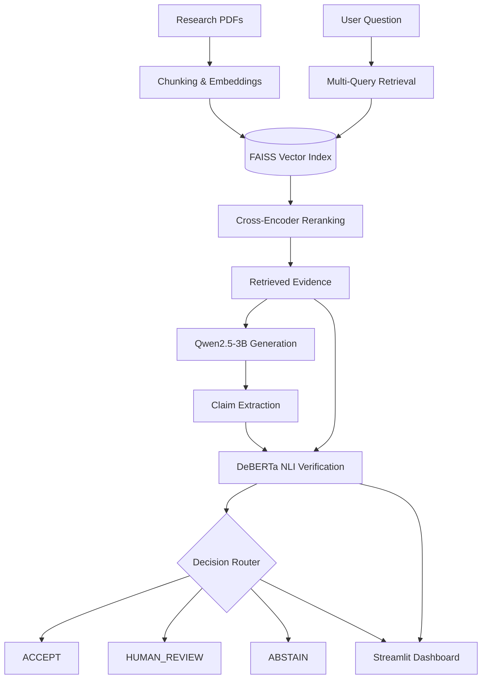

# RAGTrust
### Can Your RAG System Prove What It Says?

<p align="center">
  **An Evidence-Driven RAG Reliability & Evaluation Framework**
  <br/>
  Evaluating retrieval quality, verifying AI-generated claims, and identifying when a system should abstain.
</p>

<p align="center">
  
  
  
  
  
</p>

<p align="center">
  
  
  
</p>

---

## The Problem

RAG systems can generate fluent answers containing claims that are not actually supported by retrieved documents.

**RAGTrust evaluates whether generated answers are grounded in evidence — and when the system should avoid answering.**

## How It Works



## Key Capabilities

- **Retrieval Evaluation:** Hit@3, MRR, and evidence coverage.
- **Multi-Query Search:** Expands queries and retrieves relevant evidence using FAISS.
- **Cross-Encoder Reranking:** Reorders retrieved chunks by relevance.
- **Claim-Level Verification:** Uses DeBERTa NLI to identify entailment, contradiction, and neutral evidence.
- **Decision Routing:** Classifies responses into ACCEPT, HUMAN_REVIEW, or ABSTAIN.
- **Interactive Dashboard:** Inspects retrieval, faithfulness, claims, and routing decisions.

## Evaluation Results

### Retrieval — Development Set

| Metric | Baseline | Improved |
|---|---:|---:|
| Hit@3 | 0.375 | 0.375 |
| MRR | 0.3021 | 0.3333 |
| Evidence Coverage | 80% | 80% |

### Claim-Level Faithfulness

| Split | Supported / Total Claims | Score |
|---|---:|---:|
| Development | 42 / 120 | 35.00% |
| Test | 34 / 168 | 20.24% |

### Test Decision Distribution

| Decision | Questions | Share |
|---|---:|---:|
| HUMAN_REVIEW | 22 | 55% |
| ABSTAIN | 18 | 45% |
| ACCEPT | 0 | 0% |

**Key finding:** The low held-out faithfulness score reveals that the current pipeline still struggles to ground generated claims reliably. The routing policy also produces potential false abstentions on answerable questions.

*Retrieval metrics are development-only. Decision thresholds are provisional engineering rules, not calibrated confidence scores.*

## Technology Stack

| Component | Technology |
|---|---|
| LLM | Qwen2.5-3B-Instruct |
| Embeddings | all-MiniLM-L6-v2 |
| Vector Search | FAISS |
| Reranking | Cross-Encoder MiniLM |
| Claim Verification | DeBERTa NLI |
| Frameworks | Transformers, Sentence Transformers |
| Dashboard | Streamlit, Plotly |
| Data Processing | Python, Pandas, NumPy |

## Research Corpus

Four research papers on algorithmic recourse and counterfactual explanations.

<pre>
4 Research Papers  →  109 Pages  →  499 Chunks
                         |
                  60 Benchmark Questions
                   20 Development
                   40 Held-out Test
</pre>

## Dashboard

The Streamlit dashboard includes:

- Overview & key metrics
- Retrieval analytics
- Faithfulness and claim verification
- Decision monitoring
- Individual question and evidence inspection

**Screenshots**

Add actual dashboard screenshots to `assets/` and display them here:


## Run Locally

```bash
git clone https://github.com/YOUR_USERNAME/RAGTrust.git
cd RAGTrust

python -m venv .venv
.venv\Scripts\activate

pip install -r requirements.txt
streamlit run app.py
```

The dashboard requires the exported evaluation files in the `data/` directory. The original PDFs, FAISS index, and Colab notebook are not included by default.

## Limitations & Future Work

- Improve evidence retrieval and answer grounding.
- Reduce false abstentions.
- Improve claim segmentation and NLI verification.
- Calibrate decision thresholds using separate validation data.
- Introduce human-annotated claim-level evaluation.

---

<p align="center">
  **Retrieve with purpose. Verify with evidence. Abstain when necessary.**
  <br/><br/>
  <b>Sakshi Patil</b>
  <br/>
  <a href="https://github.com/sakshipatil-hue">GitHub</a> ·
  <a href="https://www.linkedin.com/in/sakshi-patil-58aa86327/">LinkedIn</a>
</p>
